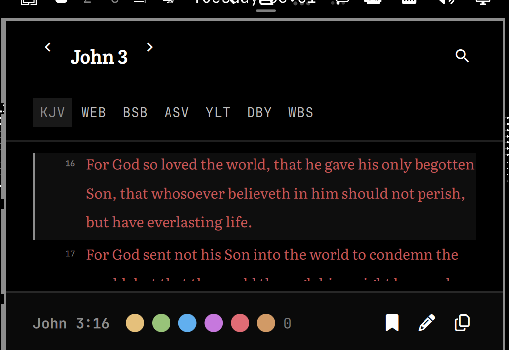

# Omarchy Bible



A Bible reader in the Omarchy bar, ported from [bible-rs](https://github.com/michaelshimeles/bible-rs). Click the book mark for a typeset reader; the panel holds seven public-domain translations, live search, highlights, notes and bookmarks. No network, no account, no copyrighted text.

## Install

```bash
omarchy plugin add https://github.com/0xSero/omarchy-bible.git
omarchy plugin enable sero.bible --section right
```

For development, drop the checkout into `~/.config/omarchy/plugins/sero.bible`, run `omarchy-shell shell rescanPlugins`, then enable it. Saving any file reloads the plugin.

### Hotkey

The panel toggles from the bar widget. Add a key in `~/.config/hypr/bindings.lua` if you want one:

```lua
o.bind("SUPER + CTRL + ALT + B", nil, "omarchy-shell shell toggle sero.bible")
```

The plugin registers the IPC target `sero.bible`, so `omarchy-shell shell toggle sero.bible` (and `summon` / `hide`) works.

## What it does

- **Reader** — verse-per-line typesetting with the verse number in the margin, section headings, poetry indents, words of Christ in red, and the KJV's translator italics. Literata is bundled for Scripture; everything else follows the bar font.
- **Translations** — KJV, WEB, BSB, ASV, YLT, DBY and WBS, all public domain. Switching keeps your place.
- **Search** — `/` searches the whole Bible as you type. Every word must appear; `"exact phrase"` and `-excluded` work. Results show a snippet and jump to the verse.
- **Jump** — `g` accepts references with fuzzy book names: `jn 3:16`, `Rom 8`, `1co13`, even `revalation 21`.
- **Study** — six highlight colours, bookmarks, and a note per verse. Copy puts the verse and reference on the clipboard.
- **Book picker** — click the chapter title for all 66 books and their chapters.
- **Remembered** — translation, place, highlights, bookmarks, notes, red-letter choice and text size live in `~/.local/state/omarchy/bible.json`.

## Scope

This is a companion panel, not a replacement for bible-rs. It keeps the reader, all seven bundled translations, search and the study marks. Parallel columns, compare view, licensed/online translation import, and JSON/Markdown export stay in the native app.

## Keys

| Key | Action |
| --- | --- |
| `j` / `k`, `↓` / `↑` | Next / previous verse |
| `h` / `l`, `←` / `→` | Previous / next chapter |
| `1`–`6` | Highlight the selected verse |
| `0` | Clear its highlight |
| `b` | Bookmark / unbookmark |
| `n` | Write a note |
| `y` | Copy verse with reference |
| `t` | Cycle translation |
| `r` | Toggle red letters |
| `+` / `-` | Larger / smaller text |
| `g` | Jump to a reference |
| `c` | Book and chapter picker |
| `/` | Search |
| `Esc` | Back, then close |

Enter in the reader copies the selected verse. Middle-clicking the bar mark copies the current reference.

## Remove

```bash
omarchy plugin remove sero.bible
```

The plugin writes only `~/.local/state/omarchy/bible.json`; remove that file too if you want to forget highlights, notes and bookmarks.

## Dependencies

None at runtime. Everything the panel reads is committed: the seven translation JSON files, Literata, and the QML. `python3` with `zstandard` plus `curl` are only needed to rebuild the text from bible-rs's `.bbl` sources.

## Data

`data/<id>.json` is generated from bible-rs's pinned `.bbl` files by `tools/build_data.py`. The converter keeps the `.bbl` structural marks and character spans, and rewrites byte offsets to QML string indices. To refresh:

```bash
tools/fetch_sources.sh
```

The generated files are committed so installing the plugin needs no Python, Rust or network. See [LICENSES.md](LICENSES.md) for every translation notice and the Literata OFL.

## Layout

```
manifest.json      plugin manifest (bar-widget)
Panel.qml          bar mark + keyboard panel + reader/search/book picker
Model.js           canon table, reference parser, verse HTML, search
data/*.json        seven public-domain translations
fonts/             Literata (OFL)
tools/             source fetch and .bbl → JSON converter
```

## License

MIT for the plugin code. Scripture is public domain as stated in [LICENSES.md](LICENSES.md); Literata is OFL.
